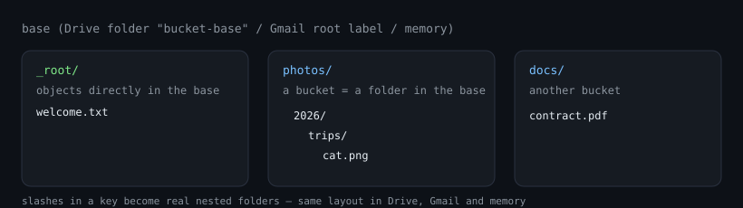

# gmail-bucket POC

[](https://github.com/Muhammad-waqar-uit/gmail-bucket-poc/actions/workflows/ci.yml)
[](LICENSE)
[](package.json)

**Use storage you already pay for as an S3-style object store.** A base folder, buckets as folders,
nested folders per key — backed by Google Drive, Gmail, or process memory, behind one interface,
with a React UI and a REST API.

> Proof of concept for demos and MVPs. Gmail and Drive are not meant to be object stores — do not ship
> this to real users, and never point it at your main account.



**Stack:** [gmail-bucket](https://github.com/Muhammad-waqar-uit/gmail-bucket) v2 (storage core, CLI, REST
server) · React 19 + TypeScript + Vite · Tailwind CSS v4 · TanStack Query · lucide-react · sonner ·
Playwright. This repo is the app: UI, entry point and end-to-end tests.

## What it does

- **Base → bucket → folder → object** layout, the same in every backend.
- **Drive backend** — the base is a real Drive folder (`bucket-base`); each bucket is a folder inside it;
  every `/` in a key becomes nested folders. Files are ordinary Drive files you can open in the browser.
- **Gmail backend** — buckets are labels under a root label; objects are messages with attachments,
  split into chunks over 12 MB, verified with an MD5 etag.
- **Memory backend** — everything in process, so the app runs (and is fully testable) without any account.
- **Base as a destination** — the reserved bucket `_root` stores objects directly in the base folder.
- **React UI** — bucket list, drag-and-drop uploads with progress, prefix filtering, image thumbnails,
  download and delete, toasts.
- **Open in Drive** — on the Drive backend each object links to its real file (`webViewLink`) and the header
  links the base folder, straight from `status.baseUrl`.
- **Move and rename** — move an object between buckets or from/to the base, or rename it in place, from the
  row action or `PATCH`. Works identically on Drive, Gmail and memory.
- **REST API** — predictable URLs, real status codes, metadata headers.
- **Tests** — a mock-Drive suite for backend logic plus Playwright API and browser tests.

## Quick start (no Google account)

```bash
npm install
npm run build
npm start            # http://127.0.0.1:4570
```

No credentials means **memory mode**: the UI, base folder, buckets, folders, uploads and the API all work;
objects disappear when the process stops. The header badge always shows the active backend.

Development with hot reload (Vite on `:5173`, proxying `/api` to the API on `:4570`):

```bash
npm run dev
```

## Real backends

### Google Drive (recommended for this layout)

1. https://console.cloud.google.com → create a project.
2. **APIs & Services → Library** → enable **Google Drive API** (and **Gmail API** if you want both backends).
3. **OAuth consent screen** → External → add your test Google account under **Test users**.
4. **Credentials → Create credentials → OAuth client ID → Desktop app** → download the JSON.
5. Save it as `%USERPROFILE%\.gmail-bucket\credentials.json` (or `~/.gmail-bucket/credentials.json`).
6. `npm run auth` — grants `drive` + `gmail.modify` in one token.
7. `STORAGE=drive npm start` (or `STORAGE=drive` in `.env`).

The base folder `bucket-base` is created in **My Drive** on first use. Set `DRIVE_ROOT_FOLDER_ID` to use a
folder you already created, or `DRIVE_CREATE_ROOT=0` to forbid automatic creation.

### Gmail

Same client, Gmail API enabled, then `STORAGE=gmail npm start`. Buckets become labels under
`gmail-bucket/`, objects become messages inside them — nothing is sent and nothing reaches the inbox.

> While the OAuth consent screen stays in **Testing**, Google expires refresh tokens after 7 days.
> Either re-run `npm run auth` or publish the app (unverified is fine for personal use).

## Configuration

Copy `.env.example` to `.env` — loaded automatically, real environment variables win.

| Variable | Default | Meaning |
| --- | --- | --- |
| `STORAGE` | `auto` | `auto` (Drive → Gmail → memory), `drive`, `gmail` or `memory` |
| `PORT` | `4570` | HTTP port for the API and the built UI |
| `HOST` | `127.0.0.1` | Bind address (`0.0.0.0` in Docker) |
| `DRIVE_ROOT_FOLDER_ID` | — | Use an existing Drive folder as the base |
| `DRIVE_ROOT_FOLDER_NAME` | `bucket-base` | Base folder name under My Drive |
| `DRIVE_CREATE_ROOT` | `1` | `0` = fail instead of creating the base folder |
| `GMAIL_BUCKET_ROOT_LABEL` | `gmail-bucket` | Gmail root label; buckets are `<root>/<bucket>` |
| `GMAIL_BUCKET_DIR` | `~/.gmail-bucket` | Where `credentials.json` / `token.json` live |
| `GOOGLE_CLIENT_ID` | — | Alternative to the credentials file |
| `GOOGLE_CLIENT_SECRET` | — | Alternative to the credentials file |
| `GOOGLE_REFRESH_TOKEN` | — | Headless/hosted mode, skips `token.json` |
| `GOOGLE_ACCESS_TOKEN` | — | Optional short-lived access token seed |
| `PW_CHANNEL` | — | Test browser: `chrome` / `msedge` when the bundled Chromium is blocked |

## The layout, precisely

```
base (Drive folder "bucket-base" / Gmail root label / memory)
├── _root/                  ← reserved bucket id: objects stored directly in the base
│   └── welcome.txt
├── photos/                 ← a bucket = a folder inside the base
│   └── 2026/trips/cat.png  ← slashes in a key become nested folders
└── docs/
    └── contract.pdf
```

`_root` is never listed as a bucket, cannot be created, and cannot be deleted — it *is* the base.

## REST API

```bash
B=localhost:4570/api

curl -X PUT  $B/buckets/photos                                     # create bucket
curl -X PUT  $B/buckets/_root/objects/welcome.txt \
     -H "Content-Type: text/plain" --data-binary 'in the base'      # object in the base
curl -X PUT  $B/buckets/photos/objects/2026/trips/cat.png \
     -H "Content-Type: image/png" --data-binary @cat.png            # object in bucket/folder/...
curl         "$B/buckets/photos?prefix=2026/"                       # list
curl         $B/buckets/photos/objects/2026/trips/cat.png -o c.png   # download
curl -I      $B/buckets/photos/objects/2026/trips/cat.png           # HEAD (etag, size, type)
curl -X PATCH  $B/buckets/photos/objects/2026/trips/cat.png \
     -H "Content-Type: application/json" \
     -d '{"bucket":"docs","key":"archive/cat.png"}'              # move or rename
curl -X DELETE $B/buckets/photos/objects/2026/trips/cat.png         # delete
curl -X DELETE "$B/buckets/photos?force=1"                          # delete bucket + contents
curl         $B/status                                              # backend, base, limits
```

Full request/response reference: **[docs/API.md](docs/API.md)**.
This is a plain REST API, not the S3 wire protocol, so the AWS SDK cannot talk to it — keep a thin
`upload()`/`download()` wrapper and swap in a real S3 client later.

## Backend library

All storage logic lives in **[gmail-bucket](https://github.com/Muhammad-waqar-uit/gmail-bucket) v2** —
the base/bucket/folder model, the Drive and Gmail backends, the `ObjectStore` interface, the memory
fallback and the REST server. This repo adds the app around it.

- Pin: `"gmail-bucket": "github:Muhammad-waqar-uit/gmail-bucket#v2.0.0"` (installing from the tag runs the
  library's `prepare` script, so `dist/` is built for you).
- Once `gmail-bucket@2.0.0` is on npm, switch it to `"^2.0.0"` — everything else stays the same.
- `npm run auth` and the backend choice are the library's; `src/main.ts` only wires env → store → server.

## Project structure

```
.
├── src/                       App shell (thin — the storage core is the library)
│   ├── main.ts                load env → createStore() → serve(info, { staticDir })
│   ├── env.ts                 Tiny .env loader (empty values treated as unset)
│   └── auth-cli.ts            `npm run auth` — OAuth for both backends (drive + gmail scopes)
├── web/                       React app (Vite)
│   ├── index.html             App shell
│   ├── vite.config.ts         Root, Tailwind plugin, /api dev proxy
│   └── src/
│       ├── main.tsx           QueryClient + Toaster providers
│       ├── App.tsx            Selected bucket + filter state
│       ├── api.ts             Typed API client (XHR uploads for progress events)
│       ├── styles.css         Tailwind import + base page styling
│       └── components/
│           ├── Header.tsx        Backend badge, base folder, refresh
│           ├── BucketsPanel.tsx  Create/select/delete buckets, base entry
│           ├── ObjectsPanel.tsx  Query, prefix filter, empty/error states
│           ├── Uploader.tsx      Drag-and-drop, destination folder, progress queue
│           └── ObjectTable.tsx   Thumbnails, download, delete
├── e2e/                       Playwright: api.spec.ts + app.spec.ts
├── scripts/drive-mock-test.mjs  DriveStore (from the installed package) vs a fake Drive client
├── docs/                      Architecture + API reference
└── playwright.config.ts       Starts the server on :4571 in memory mode
```

Deeper explanation of each module and the data model: **[docs/ARCHITECTURE.md](docs/ARCHITECTURE.md)**.

## Testing

```bash
npm run typecheck      # API, React and Playwright TypeScript
npm run test:drive     # DriveStore against an in-memory fake Drive client (37 checks)
npm run test:e2e       # builds, starts a memory-mode server, runs Playwright
npm test               # all of the above
```

- **`scripts/drive-mock-test.mjs`** exercises the `DriveStore` that ships in the installed `gmail-bucket`
  package against a fake Drive API: base folder creation, buckets as folders, nested folder creation,
  `_root` uploads, MD5 round-trip, metadata, prefix listing, in-place overwrite, delete with empty-folder
  pruning, `BucketNotEmpty`, `BucketExists`, `NoSuchKey`/`NoSuchBucket`, and the base protections. It is
  also a check that the pinned library version behaves as this app expects.
- The library's own suite (`npm run test:drive` inside
  [gmail-bucket](https://github.com/Muhammad-waqar-uit/gmail-bucket)) runs the same 37 checks against the
  source tree.
- **`e2e/api.spec.ts`** asserts the REST contract: status payload, full object lifecycle, base uploads,
  status codes (400/404/409), and SPA fallback.
- **`e2e/app.spec.ts`** drives the real UI: create a bucket, upload into it, upload into a nested folder,
  store/delete in the base, download link shape, prefix filtering, duplicate-bucket toast.

`npm run test:e2e:ui` opens Playwright's UI mode; failures keep traces, videos and screenshots in
`test-results/`.

**If Chromium will not launch** (`browserType.launch: spawn UNKNOWN`), the machine blocks Playwright's
bundled Chromium. Use an installed browser instead:

```bash
PW_CHANNEL=chrome npm run test:e2e     # or PW_CHANNEL=msedge
```

CI runs the whole suite on Ubuntu with bundled Chromium — see `.github/workflows/ci.yml`.

## Limits, caveats, safety

- Local POC: binds to `127.0.0.1`, no authentication. Do not expose it.
- Whole objects are buffered in memory; uploads are capped at 100 MB; Gmail chunks are 12 MB.
- Drive metadata lives in `appProperties`, capped at ~124 bytes per value (larger metadata is dropped).
- Listing walks folders (Drive) or reads message headers (Gmail) — keep demo buckets to hundreds of objects.
- Gmail quota is ~250 units/second/user; the clients retry 429/5xx with exponential backoff.
- Deletes are recoverable: Drive files and Gmail messages go to Trash.
- Use a throwaway Google account. Never point this at production data.

## License

[MIT](LICENSE) © Muhammad Waqar
