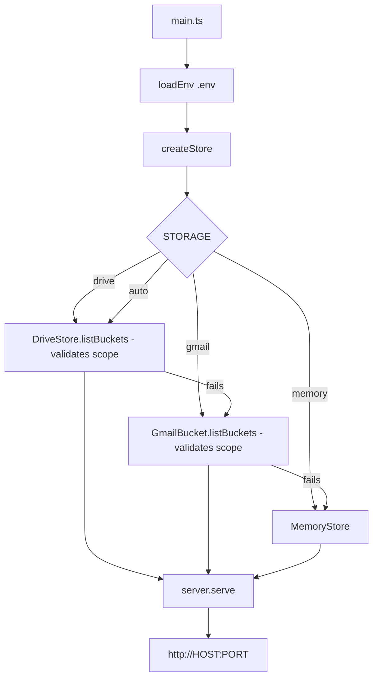
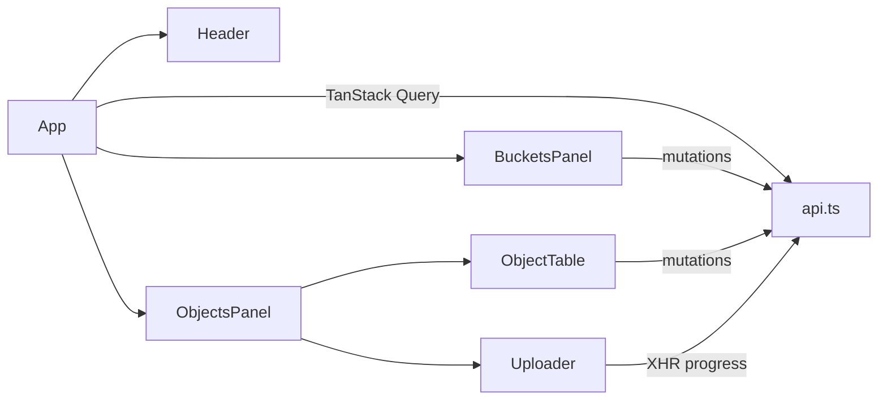
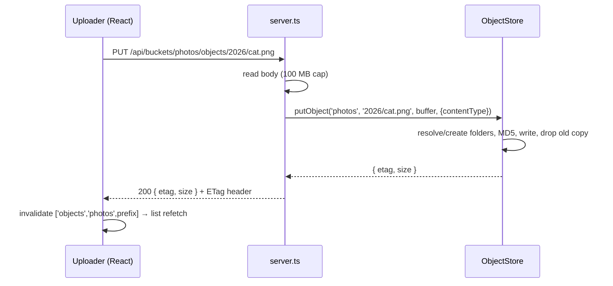

# Architecture

How the POC is put together, module by module, and how each backend maps the same base/bucket/folder
model onto Google Drive, Gmail and plain memory.

> **Where the code lives.** The storage core — layout rules, `ObjectStore`, `DriveStore`, `GmailBucket`,
> `MemoryStore`, backend selection, the REST server and OAuth — is the
> [gmail-bucket](https://github.com/Muhammad-waqar-uit/gmail-bucket) v2 package, pinned here at the
> `v2.0.0` tag. Paths marked `pkg:` refer to that package (`node_modules/gmail-bucket/…`); everything
> else lives in this repo. `src/main.ts` is the only backend-specific code left here: it loads `.env`,
> calls `createStore()` and hands the result to `serve()` with `staticDir` pointing at `web/dist`.

```ts
// src/main.ts — the whole app-side wiring
import { createStore, serve } from 'gmail-bucket';
const info = await createStore();
serve(info, { port: 4570, host: '127.0.0.1', staticDir: '../web/dist' });
```

## The one interface

Everything is expressed through `ObjectStore` (`pkg: src/store.ts`). The HTTP layer never knows which
backend is in use:

```ts
interface ObjectStore {
  createBucket(bucket: string): Promise<void>;
  listBuckets(): Promise<string[]>;
  deleteBucket(bucket: string, opts?: { force?: boolean }): Promise<void>;
  putObject(bucket: string, key: string, body: Buffer, opts?: PutOptions): Promise<{ etag: string; size: number }>;
  getObject(bucket: string, key: string): Promise<{ body: Buffer; info: ObjectInfo }>;
  headObject(bucket: string, key: string): Promise<ObjectInfo>;
  deleteObject(bucket: string, key: string): Promise<void>;
  listObjects(bucket: string, opts?: { prefix?: string; limit?: number }): Promise<ObjectInfo[]>;
}
```

`ObjectInfo` is the S3-ish metadata every backend can produce:

```ts
{ key, size, contentType, etag, lastModified, metadata }
```

Adding a backend means implementing those nine methods and adding one branch to `createStore()`.

## Startup flow



`auto` is deliberately forgiving: it reports *why* it fell back (shown in the UI header) instead of dying.
`STORAGE=drive|gmail` is strict and exits with a readable message if that backend is unusable.

## Layout rules (`pkg: src/layout.ts`)

```ts
BASE_BUCKET = '_root';
BUCKET_RE   = /^[a-z0-9][a-z0-9._-]{0,62}$/;
assertBucketName(name) // rejects _root and invalid names
```

The base is addressable as `_root` so objects can live outside any bucket. It is never returned by
`listBuckets()` and both create/delete reject it.

## Drive backend (`pkg: src/drive.ts`)

**Mapping**

| Model | Drive |
| --- | --- |
| base | folder `bucket-base` in My Drive (or `DRIVE_ROOT_FOLDER_ID`) |
| bucket | child folder of the base |
| folder in key | child folder of the bucket, created on demand |
| object | a file with `md5Checksum` and `appProperties` |
| delete | `trashed: true` |

**Details**

- `describeBase()` resolves the base once per process: an explicit id, else a `name='...' and 'root' in parents`
  lookup, else creation (unless `DRIVE_CREATE_ROOT=0`). The result is cached.
- Folder resolution is cached in `folderCache` (`parentId/name → id`) to keep API calls down.
- `putObject` splits `key` into segments, ensures each folder exists, then **updates the existing file in place**
  if one has the same name — so overwriting never leaves duplicates.
- Metadata: `appProperties.gbEtag` (md5 we computed) and `appProperties.gbMeta` (JSON, only if ≤ 120 bytes,
  because Drive caps appProperty values at ~124 bytes).
- `getObject` downloads with `alt: 'media'`, recomputes the md5 and refuses a mismatch.
- `deleteObject` remembers the folder chain, trashes the file, then trashes folders that became empty
  (bottom-up, never the bucket folder) and clears the folder cache.
- `listObjects` walks the bucket folder recursively (`MAX_DEPTH = 12`), building relative keys.
- `list` is a paginated helper; every query uses `trashed=false`.
- `DriveStoreOptions.client` is a test seam: `scripts/drive-mock-test.mjs` injects a fake Drive client.

## Gmail backend (`pkg: src/bucket.ts`)

**Mapping**

| Model | Gmail |
| --- | --- |
| base | root label `gmail-bucket` |
| bucket | label `gmail-bucket/<bucket>` |
| object | one or more messages carrying a `data.bin` attachment |
| delete | add `TRASH` to the messages |

**Details**

- Objects are written with `messages.insert` straight into the bucket label, so nothing is sent and nothing
  lands in the inbox.
- Each message carries the object's identity in headers: `X-GB-Key` (base64 key), `X-GB-Part`, `X-GB-Total`,
  `X-GB-Upload` (random id per write), `X-GB-Size`, `X-GB-Etag`, `X-GB-Content-Type`, `X-GB-Meta`.
- Objects over 12 MB are split: 12 MB keeps the base64 payload comfortably under Gmail's 25 MB attachment cap.
- Reads find the newest `X-GB-Upload` group for a key, fetch all parts (4 in parallel), concatenate and verify
  the MD5 etag.
- Overwrite writes the new copy first, then trashes the previous upload — a failed write never destroys data
  that was there.
- Listing reads `format: 'metadata'` headers for every message (that is why big buckets are slow).
- `retry()` handles 429, "rate/quota" 403s and 5xx with exponential backoff; all list/get calls go through it.

## Memory backend (`pkg: src/store.ts`)

`MemoryStore` is a `Map<bucket, Map<key, { body, info }>>` seeded with `_root`. Same rules, same errors,
zero credentials — this is what the Playwright suite and local demos run against.

## HTTP layer (`pkg: src/server.ts`)

The router ships with the library (`serve(info, { staticDir })`); the app only supplies `staticDir`.

- `createServer(info)` builds the router; `serve(info)` binds `PORT`/`HOST`.
- Routing is a small hand-written matcher:

```
/api/status                          backend + base + limits
/api/buckets                         list / create-does-not-apply
/api/buckets/:bucket                 list | create | delete
/api/buckets/:bucket/objects/:key    upload | download | PATCH (move/rename) | HEAD | delete
```

- Keys keep their slashes: everything after `/objects/` is `decodeURIComponent`-ed per segment and re-joined.
- Errors are mapped centrally (`NoSuch* → 404`, `BucketExists`/`BucketNotEmpty → 409`, validation → `400`),
  so backends only throw messages.
- Uploads are read fully into memory with a 100 MB cap (`readBody`).
- Anything that is not `/api/*` is served from `web/dist` with a MIME map, content-hash-friendly caching and
  an `index.html` fallback for client-side routes.

## Frontend (`web/src`)



- `api.ts` is the only place that knows URLs. Uploads use `XMLHttpRequest` because `fetch` has no upload
  progress events; everything else uses `fetch` with a typed wrapper that surfaces `{ error }` bodies.
- Server state lives in TanStack Query: `['status']`, `['buckets']`, `['objects', bucket, prefix]`.
  Mutations invalidate the keys they touch, so the UI stays consistent without hand-managed state.
- Component-local state is only UI state: selected bucket (`App`), filter text (`App`, debounced in
  `ObjectsPanel`), upload destination and the progress queue (`Uploader`).
- Styling is Tailwind CSS v4 (via `@tailwindcss/vite`), icons are `lucide-react`, notifications are `sonner`.

## Request lifecycle: upload



## Error and consistency model

- No locking. Concurrent writers to the same key last-write-wins; readers verify the MD5 etag so a torn read
  fails loudly instead of returning corrupt bytes.
- Gmail writes are group-scoped by `X-GB-Upload`, so a half-finished multi-chunk write is never mistaken for
  a complete object (`Incomplete object: found N of M parts`).
- Deletes are recoverable everywhere (Trash), which is why `deleteBucket` requires an explicit `force`.

## Where to extend

| Goal | Touch |
| --- | --- |
| New backend (S3, R2, local disk) | implement `ObjectStore` in the library, add a branch in its `createStore()` |
| Different layout (no buckets) | library `layout.ts` + `listBuckets` semantics |
| Auth on the HTTP API | library `serve(info, { token })` or the `GMAIL_BUCKET_TOKEN` env var |
| Streaming uploads | replace the library's `readBody` + `putObject(Buffer)` with a stream-aware variant |
| Public/presigned URLs | needs a signing layer; Drive `webViewLink` or Gmail attachment ids are not stable enough |
| UI changes (base entry, uploader, filtering) | this repo — `web/src` |

When you change the storage core, land it in the library first, tag a release, then bump the pinned tag
here; `npm run test:drive` fails if the installed version drifts from what the app expects.
